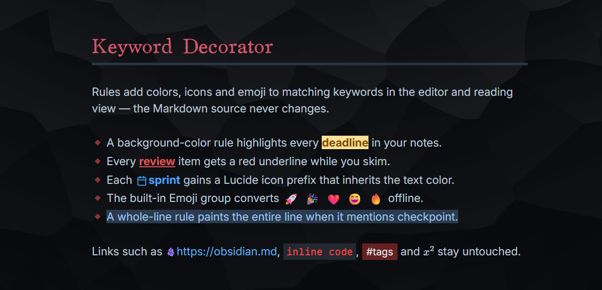
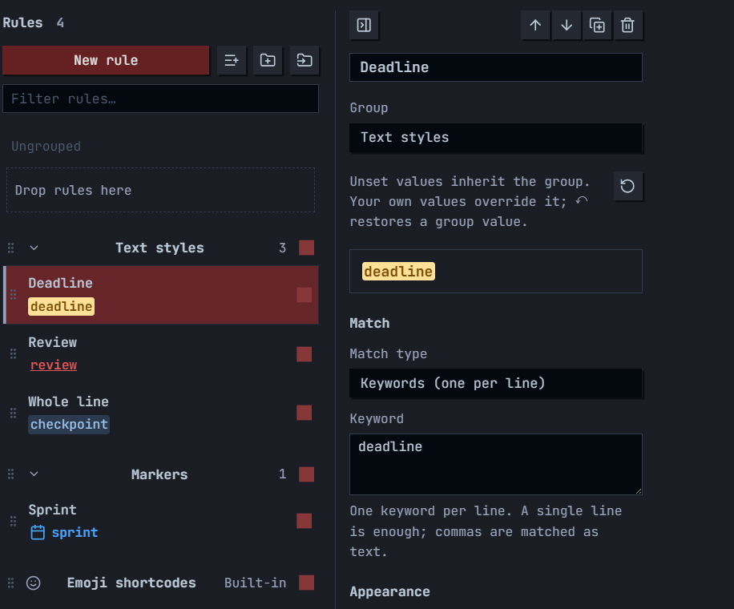

# Keyword Decorator

[](https://obsidian.md/plugins?id=keyword-decorator) [](https://github.com/Moyf/keyword-decorator/releases) [](https://github.com/Moyf/keyword-decorator/issues) [](https://github.com/Moyf/keyword-decorator/stargazers)

English | [中文文档](README-zh.md)

Give keywords a visual marker in Obsidian's editor and reading view. Rules can add text styles, emoji, Lucide icons, vault images, or pasted SVG artwork without changing your notes.



## How to use

Open **Settings → Keyword Decorator** and create a rule. Choose **Keywords (one per line)** or **Regular expression**, then pick an appearance. One line matches one keyword; several lines share the same appearance. Changes save automatically and the preview updates as you type.

## Highlights

### A workbench for many rules



The rule workbench is built for vaults with dozens of rules:

- **Groups** organize rules, fold and expand, and toggle a whole set together. Shared group appearance is inherited by every rule until a rule overrides a field — ↶ restores inheritance.
- **Fast reordering**: drag a rule, a selection, or a whole group; Move up / Move down buttons and `Alt + ↑ / ↓` work too. Earlier rules win overlapping matches.
- **Multi-selection**: Ctrl/Cmd-click to toggle rules, Shift-click for a visible range, then drag the selection together — even across groups — with relative order preserved.
- **Bulk add** pastes keyword lines, spreadsheet columns, or a JSON rule array, previews the result, and creates one editable rule per entry.
- **Import and export** move rules with their order, groups and switches preserved; group exports add a single group with collision-safe IDs.
- Autosave, filtering, duplication, deletion undo and a responsive two-pane layout with independently scrolling panes are built in.

### Markers beyond text styles

- **Emoji shortcodes**: a built-in group converts `:smile:` → 😄 and 1,913 more aliases, fully offline via a bundled dictionary. Unknown names stay unchanged, and **Hide matched text** leaves only the emoji — move the cursor into a match to edit the original shortcode.
- **Lucide icons**: search icons with suggestions and previews; icons inherit the rule's text color by default.
- **Vault images and SVG**: pick vault images by name or path with thumbnails, paste complete SVG markup, or use direct image URLs. Width, height and hide-text are configurable; failed loads leave the original text readable.

### Whole-line styling

Enable **Apply style to the whole line** to paint the logical line containing a match, soft wrapping included. Regular-expression `^` and `$` anchors match each logical line consistently in the editor and reading view.

### Precise boundaries

Decorations stay inside Markdown note bodies in Live Preview and Reading view; source mode keeps the original text unless you opt in. Links (labels, destinations, aliases, bare URLs), code, math, properties, tags, embeds and formatting markers are always skipped, while headings, lists, quotes, callout prose and tables remain eligible. Custom CSS is scoped to the note body with `&` targeting this rule's matches:

```css
& {
  border-bottom: 2px dashed currentColor;
  border-radius: 4px;
  padding: 0 4px;
}
```

## Features

### Decoration boundaries

Decorations apply to Markdown note bodies in Live Preview and Reading view. Source mode shows the original text by default; enable **Decorate source mode** to opt in, with the same content exclusions as Live Preview. Quick Switcher, suggestions, hover previews, settings and other rendered UI remain outside this scope.

Links are excluded, including their labels, destinations, wiki-link aliases, references and bare URLs. Code, math, properties, tags, embeds and Markdown formatting markers are also skipped. Headings, lists, quotes, callout prose and tables remain eligible. Whole-line appearance skips protected content on that line.

Custom CSS is scoped to the note body and to enabled decoration editors. Global directives such as `@import`, `@font-face` and `@keyframes` are ignored.

### Rule workbench

Open **Settings → Keyword Decorator** to manage rules:

- Use the master switch to pause all decorations and each rule's switch to pause one rule.
- Drag a rule by its grip to change priority, focus its grip and press `Alt + ↑ / ↓`, or use the editor's arrow buttons. Press Esc to cancel a drag. New rules focus the Keyword field immediately.
- Ctrl/Cmd-click rules to toggle selection, Shift-click to select a visible range, or Ctrl/Cmd + Shift-click to add a range. Drag any selected rule's grip to move the selection together, including between groups; original relative order is preserved.
- Duplicate a rule to reuse its appearance. Deleting a rule offers a short undo action.
- Search the rule list by name or keyword. The list and editor use equal columns and scroll independently. Collapse the editor to browse only rules until you select one again. At 620 CSS px of content width or less, selecting a rule opens its editor; modifier-clicking keeps the list open for multi-selection.

### Groups and appearance

Create groups with the folder-plus button. Double-click a group name to fold or expand it; single-click to edit without moving the list. Toggle all its rules together, drag rules between groups, or drag a group to move its rule block. The group editor also has Move up / Move down buttons; the first and last positions disable the unavailable direction. The rule editor has a Group selector. Ungrouped rules come first, followed by groups in list order; earlier rules win overlapping matches.

Use **Export group** in a group's editor to export only its rules, order, shared appearance and switches. **Import groups** beside New group adds the exported groups as new content. Repeated imports create separate groups and remap rule references, preserving existing groups, rules and the master switch. Empty groups are supported.

Click a group name to configure shared appearance. Unset rule fields inherit the group; explicit values, including disabled toggles or cleared colors, override it. Use ↶ beside a field to restore inheritance, or reset all appearance fields from the rule editor. Disabling a group preserves each rule's own switch. Full exports preserve groups, group order and appearance.

Lucide icons offer keyword suggestions with a preview and name. Icons inherit text color by default; this can be turned off. Each marker type remembers its own value. Background color can optionally include the prefix marker.

### Emoji shortcodes

The default **Emoji shortcodes** group displays `:smile:` as 😄, `:heart:` as ❤️ and `:happy:` as 😄, in both the editor and reading view. Its single rule recognizes 1,914 aliases using a bundled local dictionary. No images, extra runtime dependency or network connection are required; appearance follows the device's emoji font. Unknown names stay unchanged. Discord server custom emoji and animated emoji are not included.

This is a special built-in group, marked **Built-in** in the list. Click its name for **Enable conversion** and **Hide matched text**; it has no ordinary rule list or match-type selector. Normal rules offer only Keywords and Regular expression. The group is added once after existing rules, preserving their priority; existing presets are recognized with their saved appearance and disabled state intact.

**Hide matched text** is enabled initially: move the cursor into a match to edit the original shortcode, or turn the switch off to show the emoji alongside its shortcode. Notes keep their original Markdown. The built-in group can still be reordered to change its priority; new custom rules are created outside it.

The aliases come from [gemoji](https://github.com/github/gemoji), with an additional `happy` alias. See [THIRD-PARTY-NOTICES.md](THIRD-PARTY-NOTICES.md) for the pinned source and license.

### Images and SVG

Choose **Vault image** to search image names and full paths, with thumbnails. The picker saves the full vault path so files with identical names in different folders remain distinct. You can also enter a vault path or wikilink manually.

Choose **SVG code** and paste a complete `<svg>…</svg>` element. Active content and external references are removed before display. Configure width and height in pixels; images keep their proportions inside this box.

Choose **Image URL** to paste a direct HTTP or HTTPS image link, including URLs with query parameters. Network images share the same size and hide-text controls as vault images. The preview loads the image directly from its host, without sending a referrer. Invalid links and failed loads leave the original text readable.

**Hide matched text** is off by default for ordinary rules. For emoji, image and SVG markers, it leaves only the marker visible. Move the editor cursor into a match to reveal and edit its original text. The underlying Markdown is preserved.

The plugin runs locally. An image URL beginning with `https://` or `http://` connects to that image's host when displayed; using vault images or pasted SVG avoids these network requests. No account, telemetry, or paid service is required.

### Bulk add

Use the list's **Bulk add** button. Each line creates a separate rule:

```text
Obsidian
Review
Important
```

Paste tab-separated columns from a spreadsheet to give each rule its own name, keyword, and optional vault image:

```tsv
Name	Keyword	Image path (optional)
```

The first row is data too; omit column headings. A JSON rule array or previously exported rule package is also accepted. Preview the rule count and fix any errors before adding. You can optionally inherit the selected rule's appearance.

Several lines in a **Keywords** rule share one appearance. **Bulk add** creates independent rules that you can edit individually. Commas in the new Keywords mode are literal text; legacy comma-separated rules keep their original matching behavior and are displayed as separate lines when opened for editing.

### Import and export

Export copies or downloads a JSON package with rules, priority, and master-switch state. Older exports containing a map of rule IDs are also accepted. Import validates pasted JSON or a selected file automatically and defaults to appending new content. You can explicitly choose to update matching IDs or replace all rules. The empty-replacement confirmation appears only when needed. Summaries and footer actions stay visible while editing.

### Performance

Editor matching is restricted to visible content. Matchers are compiled when rules change; saves are debounced and serialized. Image resolution is cached, and disabled rules skip matching. Avoid complex regular expressions: JavaScript cannot safely interrupt a pathological expression on the UI thread. See [DEVELOPMENT.md](DEVELOPMENT.md) for validation details and development commands.

## Installation

The plugin will be available directly from the [Obsidian plugin browser](https://obsidian.md/plugins?id=keyword-decorator).

Alternatively, you can install with [BRAT](https://github.com/TfTHacker/obsidian42-brat) by using the following link: `https://github.com/Moyf/keyword-decorator`.

## Acknowledgments

- Built on [Dynamic Highlights](https://github.com/nothingislost/obsidian-dynamic-highlights) by [NothingIsLost](https://github.com/nothingislost) ❤️ — Keyword Decorator is a ground-up redesign and extension of that work
- Emoji aliases come from [gemoji](https://github.com/github/gemoji) by GitHub — see [THIRD-PARTY-NOTICES.md](THIRD-PARTY-NOTICES.md)

## More from Moy

If you appreciate my plugin design and quality, check out my other Obsidian plugins:

| Plugin | Description | Stats |
| --- | --- | --- |
| [Yearly Glance](https://github.com/Moyf/yearly-glance) | See your whole year's key events at a glance. | [](https://obsidian.md/plugins?id=yearly-glance) [](https://github.com/Moyf/yearly-glance/stargazers) |
| [Easy Copy](https://github.com/Moyf/easy-copy) | Easily copy formatted text, or copy elegant links. | [](https://obsidian.md/plugins?id=easy-copy) [](https://github.com/Moyf/easy-copy/stargazers) |
| [Better Links](https://github.com/Moyf/better-links) | The link popover editor you absolutely need. | [](https://obsidian.md/plugins?id=better-links) [](https://github.com/Moyf/better-links/stargazers) |
| [Style Context](https://github.com/Moyf/style-context) | Set your Obsidian background to any image in your vault. | [](https://obsidian.md/plugins?id=style-context) [](https://github.com/Moyf/style-context/stargazers) |
| [Colorful Highlights](https://github.com/Moyf/colorful-highlights) | Enhanced colorful highlights with multiple styles and custom colors. | [](https://obsidian.md/plugins?id=colorful-highlights) [](https://github.com/Moyf/colorful-highlights/stargazers) |
| [Single Choice Property](https://github.com/Moyf/single-choice-property) | Keep selected list properties to only one value. | [](https://obsidian.md/plugins?id=single-choice-property) [](https://github.com/Moyf/single-choice-property/stargazers) |

> See all my plugins on my [Obsidian Community page](https://community.obsidian.md/users/moyf).

Friend plugins I contributed to: [Note Toolbar](https://github.com/chrisgurney/obsidian-note-toolbar) & [Typify](https://github.com/leike-dev/Obsidian-Typify) ❤️

## Support

If you like Keyword Decorator, consider [buying me a coffee on Ko-fi](https://ko-fi.com/moy) ☕

## Development

```sh
npm install
```

Copy `.env.example` to `.env` and set `VAULT_PATH` to an existing Obsidian vault containing `.obsidian`. The copy script reads the process environment first, then `.env` files in the repository and parent directories. Relative vault paths resolve from the matching `.env` directory.

```sh
npm run test
npm run lint
npm run build:local
```

Build outputs are in `dist/`. Local builds copy only plugin assets, preserving the vault's existing `data.json`. Reload the plugin, then open its settings. Use `npm run build:local:set` to build and open settings when Hot Reload is active.

## License

MIT. Based on the original work by NothingIsLost.
